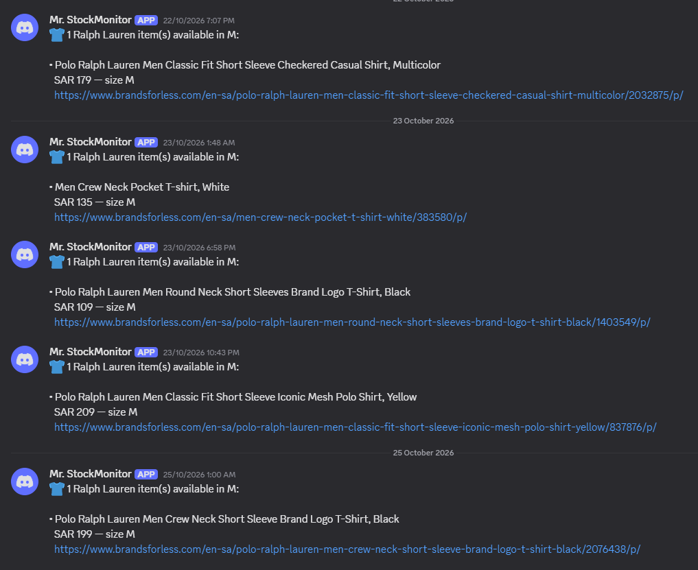

<div align="center">

# Brands For Less Size Watcher

**Your size is back. Your Discord knows.**

Monitor Brands For Less search results for your preferred sizes and receive Discord alerts when matching items come back in stock, without leaving your computer running.

  

[Quick start](#quick-start) · [Configuration](#configuration) · [How it works](#how-it-works) · [Troubleshooting](#troubleshooting)

</div>

## See it in action

When an item appears in your target size, the watcher sends a Discord notification with its name, price, size, and product link.



> Example alerts for **size M**. Products, prices, and stock availability change over time.

## Features

- **Automatic checks:** Run on a GitHub Actions schedule or launch a check manually.
- **Size-specific alerts:** Watch one size or several, such as `M,L`.
- **Discord notifications:** Get product details and a direct link when a match is confirmed.
- **Fewer repeat alerts:** `state.json` tracks notified matches and allows new alerts after an item goes out of stock and returns.
- **Low request usage:** Read sizes from the search results page first, then verify matching product pages.
- **No always-on PC:** GitHub-hosted runners do the checking.

## Quick start

### 1. Get a Scrape.do API token

Create an account at [Scrape.do](https://dashboard.scrape.do/sign-up), then copy your API token from the dashboard. Check the provider's current free-tier limits and pricing before relying on them.

**Why a proxy?** Brands For Less may reject requests from datacenter IPs, including those used by GitHub Actions. The watcher uses Scrape.do to make requests through an accepted route, with Saudi Arabia selected by default.

### 2. Create a Discord webhook

In your Discord server, go to **Server Settings → Integrations → Webhooks → New Webhook**. Choose a channel and copy the webhook URL.

> Webhooks post to server channels, not directly to DMs. For private alerts, create a server that only you can access.

### 3. Add GitHub Actions secrets

Open your repository's **Settings → Secrets and variables → Actions → New repository secret** and create:

| Secret | Value |
| --- | --- |
| `SCRAPEDO_TOKEN` | Your Scrape.do API token |
| `DISCORD_WEBHOOK_URL` | Your Discord webhook URL |

**Keep these credentials private.** Do not put actual tokens or webhook URLs in `.github/workflows/check.yml` or commit them to Git.

### 4. Run your first check

1. Open **Actions → BFL size watch → Run workflow**.
2. Select **debug** mode and start the run.
3. Open the run's **Check stock** step to review the discovered products and sizes.
4. Run it again in **test alert** mode to verify Discord delivery.

An illustrative debug run looks like this:

```text
Route  : scrape.do proxy (geo=sa)
Found  : 5 product(s)

- Polo Ralph Lauren Men Regular Fit Drawstring Jogger Pants, Grey
    in stock: XS
...
Scrape.do credits used this run: ~1
```

A normal run only sends a stock alert when an item matches your configured size and passes the product-page verification.

### 5. Let it run automatically

The included schedule is **03:00 UTC daily (06:00 in Riyadh)**. GitHub Actions scheduled workflows can start later than their scheduled time.

## Configuration

Edit the `env:` block in `.github/workflows/check.yml`:

| Variable | Default | Purpose |
| --- | --- | --- |
| `BFL_SEARCH_URL` | Men's Ralph Lauren search | Search or category page to monitor |
| `BFL_TARGET_SIZES` | `M` | Comma-separated target sizes, e.g. `M,L` |
| `BFL_GEO` | `sa` | Scrape.do proxy country |
| `BFL_UNAVAILABLE_HINTS` | `disable,sold,...` | Markers used to identify unavailable sizes |

To monitor a different brand or category, search for it on Brands For Less, then paste the results URL into `BFL_SEARCH_URL`.

**Important:** Only the **first page** of results is checked. If your search spans multiple pages, apply filters until the items you care about fit on one page.

## How it works

```text
GitHub Actions (daily or manual)
          │
          ▼
  Load BFL search results
          │
          ▼
  Read product sizes from cards
          │
          ▼
  Any target-size matches?
       /          \
      No          Yes
      │            │
      │            ▼
      │     Verify product page
      │            │
      │            ▼
      │     Check saved alert state
      │            │
      │            ▼
      │     Send new Discord alerts
      │            │
      └──────┬─────┘
             ▼
       Update state.json
```

Most checks need only the search results page. When a size matches, the watcher opens that product's page for confirmation before notifying you.

`state.json` records which matching items have already triggered an alert. An item that stops matching is removed from the tracked matches, so a later restock can trigger a fresh alert. For reliable deduplication across separate GitHub Actions runs, the workflow must preserve the updated state between runs.

## Proxy usage and credits

The script tries a datacenter route first and switches to a residential route if blocked. The original cost assumptions are **1 credit for a datacenter request** and **10 credits for a residential request**, with failed attempts treated as free. Confirm the current charging rules with Scrape.do.

At one check per day, usage may be roughly **30 to 300 credits per month**, before additional requests for matching products. Each run reports estimated consumption. Monitor your actual balance in the [Scrape.do dashboard](https://dashboard.scrape.do/).

To reduce checks, change the workflow's cron expression. For example:

```yaml
# Every other calendar day of the month at 03:00 UTC, approximately
- cron: '0 3 */2 * *'
```

> `*/2` in the day-of-month field is not an exact rolling 48-hour interval across month boundaries.

## Troubleshooting

| Problem | What to try |
| --- | --- |
| `no products parsed` | Run in debug mode. The site's HTML may have changed and the parser may need an update. |
| Every product appears to have every size | Recalibrate the sold-out markers using `python bfl_watch.py --calibrate "<product URL>"`, then update `BFL_UNAVAILABLE_HINTS`. |
| `Scrape.do rejected the token` | Check that `SCRAPEDO_TOKEN` exists and has the correct value. |
| `out of credits` | Check your Scrape.do dashboard and reduce the schedule if needed. |
| `403 Forbidden` | Confirm the log reports `Route : scrape.do proxy`, not `direct`. |
| No Discord alerts | Check `DISCORD_WEBHOOK_URL`, run **test alert**, and confirm there are verified size matches. |
| Repeated notifications | Verify that the workflow carries `state.json` forward between runs. |

## Run locally without a proxy

You can also run the watcher from your own computer. If your home connection can reach Brands For Less directly, leave `SCRAPEDO_TOKEN` unset and the script will use direct requests. See the Windows Task Scheduler version in the other folder if you prefer local scheduling.

---

<div align="center">

**Made for the moment your size comes back.**

</div>
